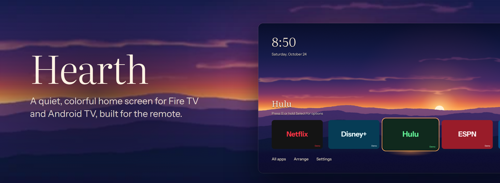
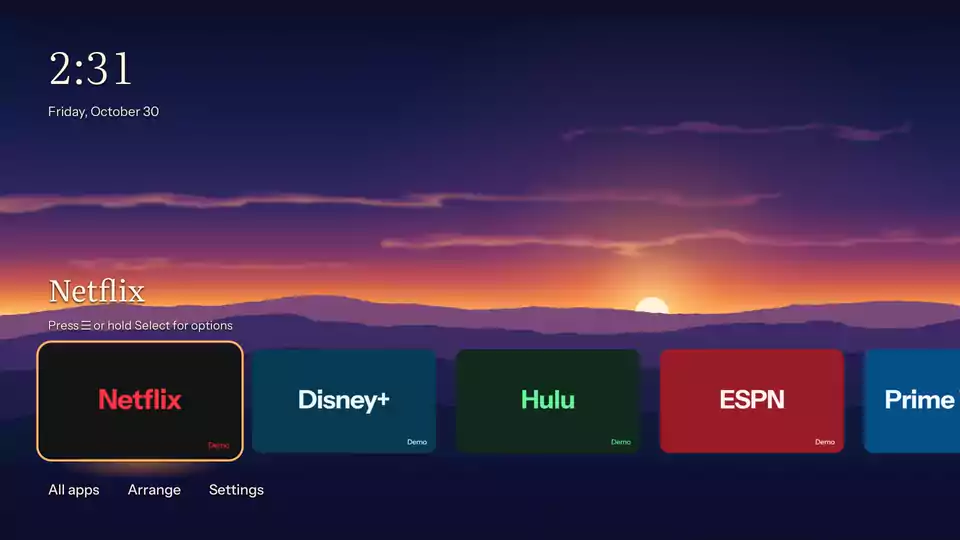
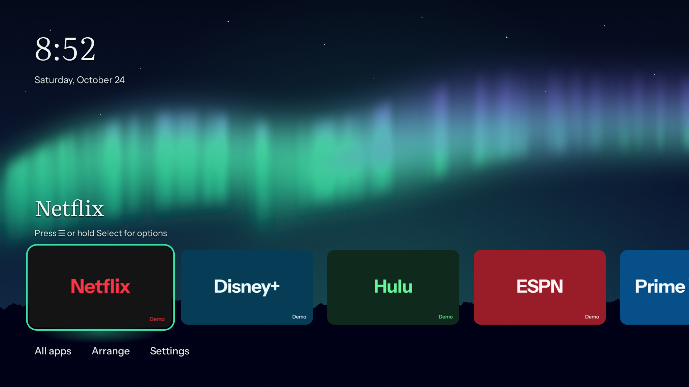

# Hearth



**A calm, colorful home screen for Fire TV and Android TV.**

Your favorite apps, a clear selection, and a landscape with room to breathe.
Hearth is built for the remote and the sofa, with original artwork and gentle
motion. No ads, recommendations, accounts, or analytics. It works offline;
weather is optional and off by default.

[](https://github.com/jameskbb/hearth/actions/workflows/ci.yml)
[](LICENSE)

[Get started](#get-started) · [Theme gallery](docs/themes.md) ·
[Compatibility](#compatibility) · [Contribute](CONTRIBUTING.md)



*Recorded on an Android TV emulator. [Watch in 1080p](docs/media/tour.mp4).
The tour stays inside Hearth without opening any apps.
The service-name tiles are local, offline demo apps, not official clients.
On your TV, Hearth uses your installed apps' artwork. Hearth is not affiliated
with the services shown. [About the demos](docs/demo-apps.md).*

## Make yourself at home

- **Your apps, in your order.** Pin favorites, rearrange them with Left and
  Right, and hide apps you do not use. All apps keeps the rest within reach.
- **Comfortable with a remote.** Large tiles, a clear focus ring, and a
  selection that returns when you come back from an app. Press Menu or hold
  Select for options. Back at Home stays in Hearth.
- **Thirteen original scenes.** Choose one, follow an editable daily schedule,
  or let Surprise Me pick once a day. Seven everyday landscapes sit alongside
  Open Bay and five seasonal scenes, including a gentle fall harvest theme.
- **Motion at your pace.** Slow clouds, haze, and light give the artwork life.
  Reduce motion makes every scene still and turns off focus scaling and fades.
- **A few personal touches.** Add an optional Home label, show local weather,
  or pin HDMI inputs when your TV exposes a supported route.

| | |
|---|---|
|  |  |
| Aurora, one of seven everyday scenes. | Christmas, one of five seasonal scenes. |

[Explore all thirteen themes](docs/themes.md), or
[make your own theme pack](docs/theme-packs.md) from images and a small manifest.

## Get started

Hearth is an early **v0.1** project for people comfortable sideloading an APK.
Build from source with Git, **JDK 17**, Android SDK **platform 35**,
**build-tools 35.0.0**, and **platform-tools** (ADB).
Set `ANDROID_HOME` to your SDK directory, or set `sdk.dir` in an untracked
`local.properties` file.

```bash
git clone https://github.com/jameskbb/hearth.git
cd hearth
./gradlew assembleDebug
adb connect <tv-ip>:5555
adb install -r app/build/outputs/apk/debug/app-debug.apk
adb shell am start -n io.github.jameskbb.hearth/.MainActivity
```

Replace `<tv-ip>` with your TV's address and accept its ADB authorization prompt.
The [installation guide](docs/install.md) covers enabling ADB, building a
minified release APK, signing, updates, and uninstalling. For lasting installs,
keep your signing key: an APK signed with another key cannot update your app
while preserving its preferences. CI APKs are development artifacts with a
temporary debug signing identity, not stable signed releases.

**On Fire TV, installing Hearth does not make Home open it.** Amazon's launcher
stays enabled. A separate Home-button helper may be needed, and support varies
by firmware. Read the [Home-button guide](docs/home-button.md) before setting
one up. On Android TV, the platform controls whether you can choose a home app.

## Compatibility

| Area | Current coverage |
|---|---|
| Installation minimum | Android TV 5.0 / API 21, including Android-based Fire OS 5 and later. |
| Automated framework checks | Every Android API from 21 through 36 in CI using Robolectric. |
| Native checks | Android TV emulator checks and limited physical Fire TV checks, documented in the testing guide. |
| Home button, boot, and vendor behavior | Separate device and firmware checks; installing the APK does not guarantee these integrations. |

Framework tests exercise API compatibility, preferences, fonts, parsing, and
platform routes. They do not establish GPU rendering, remote timing, or
performance on every TV. Seasonal artwork and newer scheduling features still
have physical-panel checks outstanding. See [testing](docs/testing.md) and
[known follow-ups](docs/follow-ups.md) for the evidence and remaining work.

## Privacy

Favorites, hidden apps, theme settings, and the optional Home label stay on your
TV. Hearth has no accounts, analytics, or Google Play Services. Fonts and theme
artwork are bundled, with no runtime downloads.

When you enable weather, city searches and the selected city's coordinates go
to [Open-Meteo](https://open-meteo.com/) over HTTPS. Like any internet service,
it also receives your network address. Hearth does not request device location
permission. Turn weather off to stop its requests.
Read the [privacy details](PRIVACY.md).

## Contributing

Bug reports, documentation fixes, compatibility reports, and theme contributions
are welcome. Start with [Contributing](CONTRIBUTING.md) for the build setup,
tests, and design guidelines. Open an [issue](https://github.com/jameskbb/hearth/issues)
with reproducible steps and an Android or Fire OS version. Please leave private
device identifiers and signing details out of reports.

For sensitive reports, follow the [security policy](SECURITY.md).
Please follow the [community guidelines](CODE_OF_CONDUCT.md).

Hearth uses Kotlin and Jetpack Compose for TV. Dependencies are pinned, and
CI checks builds, lint, JVM tests, the Android framework matrix, and repository
safety. The [product brief](docs/BRIEF.md), [design spec](docs/design.md), and
[decisions](docs/decisions/) explain the direction.

## More to explore

- [Install, update, and roll back](docs/install.md)
- [Themes and scheduling](docs/themes.md), [theme pack format](docs/theme-packs.md)
- [Display, color, and banding](docs/display.md)
- [Testing](docs/testing.md) and [recording screenshots](docs/recording-media.md)
- [Public repository preparation](docs/public-readiness.md)

## License and credits

Hearth's code and original artwork are [MIT licensed](LICENSE). Literata and
Instrument Sans are included under the SIL Open Font License 1.1. Optional
weather data is by Open-Meteo under CC BY 4.0. Service names in the demos belong
to their respective owners. Full notices are in [third_party](third_party/README.md).
