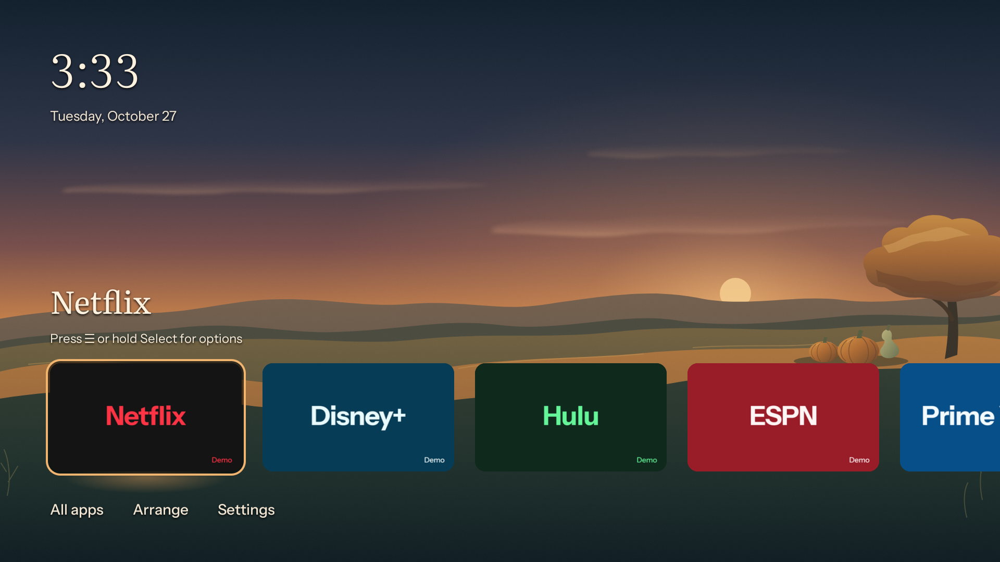
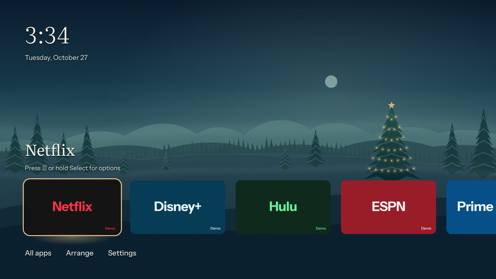
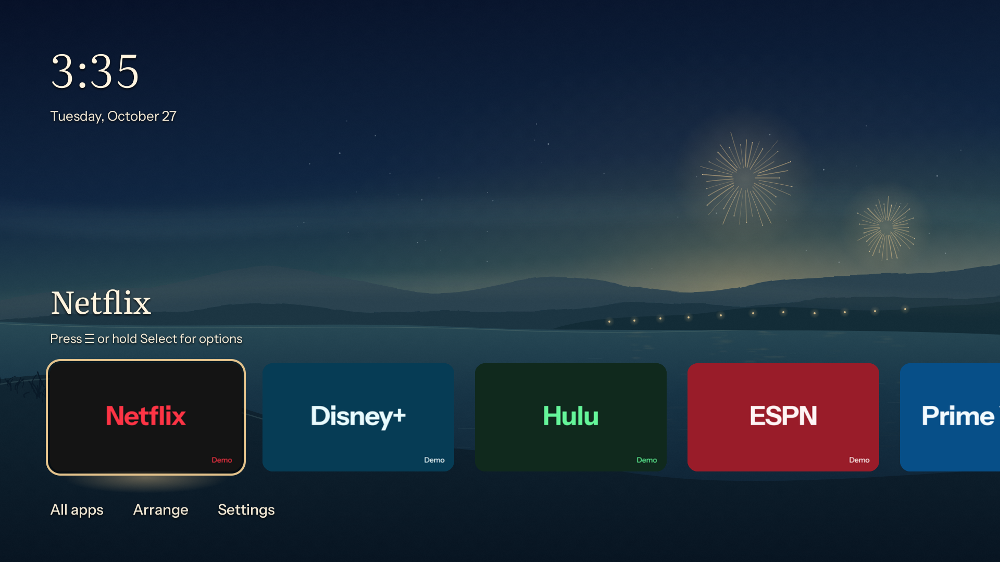
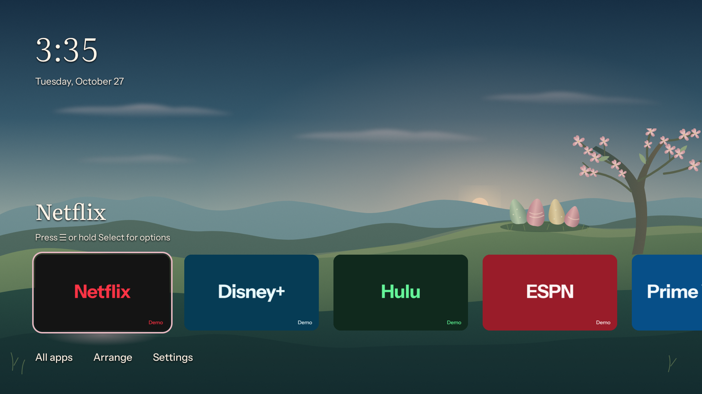
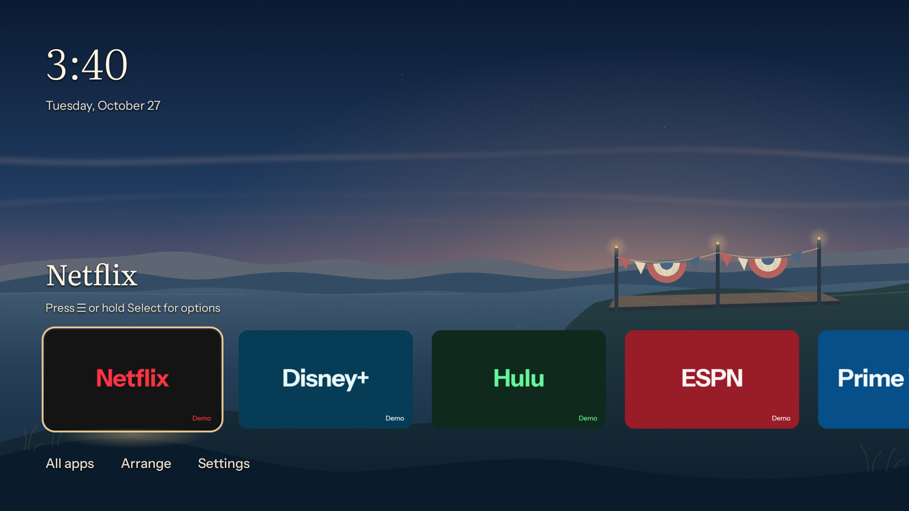

# Seasonal themes

Five occasion packs extend the existing scene collection: Harvest Evening
(Halloween as fall harvest), Christmas, New Year, Easter and July Fourth.
Their editable SVG layers live in `design/art/<id>/`, with rendered packs in
`app/src/main/assets/themes/<id>/`. Each source folder records its artwork
provenance and motion choices in `notes.txt`.

## Direction contract

**Thesis:** seasonal atmosphere within Hearth's quiet landscape collection.
Holiday details belong in the environment, with uncarved pumpkins for harvest,
steady Christmas lights, champagne accents for New Year, spring colors for
Easter and restrained red, cream and blue for July Fourth.

**Own world:** retain the layered SVG art, fine anti-banding grain, deep blue
or green shadows, warm light, existing type and focus treatment. No new UI
surfaces, artwork text or personalized labels.

**Story:** choose a seasonal scene in Appearance and return to the same Home
layout. All five are manual by default, with explicit opt-in to custom
rotation pools or schedule periods.

**First viewport:** full-bleed 1920x1080 art, quiet clock and weather space
at upper left, title space at upper right, and dark lower foreground behind
the favorites and actions. Holiday details sit toward the right near the
horizon, where they can be enjoyed above the app tiles.

**Form:** extend the established landscape composition from Dusk, Misty Forest
and Golden Prairie. The existing manifest drives slow, sustained atmospheric
motion; terrain and decorations remain still. No concept seed is needed for
this extension of the existing design.

**Finish:** review every rest render and motion sheet, verify the shipped packs
and document their limits. Preserve the existing design system and record
provenance for all new artwork.

## Behavior

Every pack sets `autoRotationEligible: false` and has no recommended dayparts.
The seven everyday scenes and recommended schedule keep their existing
behavior. Seasonal packs can be used at any time of year; there is no date
detection, holiday scheduler or network access.

Only atmospheric layers move. Reduce motion draws the shared renderer's rest
state, and leaving Hearth suspends animation through the existing lifecycle
handling. No flashing lights or rapid fireworks are part of these packs.

| Pack | Sustained motion | Decoded layers |
|---|---|---|
| Harvest Evening | Clouds drift at 21.3 dp/min | 13.3 MiB |
| Christmas | Clouds and powder drift at about 20 dp/min | 14.2 MiB |
| New Year | Haze drifts at 18 dp/min; reflections glide and breathe slowly | 9.1 MiB |
| Easter | Clouds drift at 21 dp/min | 13.7 MiB |
| July Fourth | Clouds drift at 20.3 dp/min; water reflections glide slowly | 8.8 MiB |

All five are below the 32 MB decoded limit. Their rendered layer files and
gallery previews add about 5.7 MiB to the APK before ZIP overhead. Artwork is
authored locally as SVG, with no third-party images or additional dependencies.

## Verification

Final comparison against Dusk, Golden Prairie and Misty Forest found no
material drift from the existing landscape system. The rest renders and Home
captures retain quiet header space, layered terrain, a dark foreground and
the existing typography and focus treatment. All five source manifests match
their shipped copies and use the existing palette roles and motion format.
This extension adds artwork and pack palettes without changing UI components,
fonts, shared tokens or renderer behavior.

`scripts/check.sh` passes, including all 388 app JVM tests and fixture/demo
builds. `./gradlew assembleDebug` passes. Bundled-pack tests validate all thirteen
packs, source/shipped manifest parity, layer coverage throughout motion, and
sustained movement at 0, 240 and 600 seconds. Rotation tests verify seasonal
exclusion from automatic pools and explicit selection of every special pack.

Each theme's base passes the existing banding check. Rest renders and initial
motion sheets were inspected; late-motion frames check that the scene continues
moving after ten minutes. At 1080p, sampled date, hint and action text regions
keep at least 4.5:1 contrast through the tested motion phases, even without
counting the glyph shadow. The shared renderer and lifecycle handling are
unchanged. Physical-panel frame pacing, memory and sofa-distance readability
still require the [device checklist](testing.md).

## TV captures

Captured at 1920x1080 on the API 28 Android TV emulator with
`scripts/screenshots.sh`. Reduce motion is on to show the rest state. The
clock is the emulator's local time, weather is off, and the app banners are
the repository's offline demos. Harvest Evening and July Fourth were set
through temporary local preference fixtures. Christmas, New Year and Easter
were selected with D-pad and Select through Appearance. The original
preferences were restored after capture.

This run used software emulation without hardware acceleration. During the
long navigation sequence, both Hearth and the system launcher reported input
timeouts. July Fourth was captured separately after restarting Hearth. These
captures validate rendering, with no claim of sustained remote responsiveness
or frame pacing. Repeat those checks on an accelerated emulator or physical TV.

| Harvest Evening | Christmas |
|---|---|
|  |  |

| New Year | Easter |
|---|---|
|  |  |



## Reproduce

Use the documented JDK 17 and Android SDK, Chrome, and a Python interpreter
with Pillow and numpy:

```bash
REVIEW_DIR=build/seasonal-review scripts/render-theme.sh \
  harvest-evening christmas new-year easter july-fourth
scripts/check.sh
./gradlew assembleDebug
```

For a late-motion sheet, use `scripts/theme-compose.py` with
`--frames 6 --start-seconds 600 --seconds 240 --contact-sheet <output.png>`.
The README shows the packs' rest renders. Device checks for readability,
frame pacing, lifecycle and memory remain in [testing.md](testing.md).
