# Theme gallery

Thirteen bundled theme packs: seven everyday scenes and six special themes, all
original art. Each is drawn in layers that move slowly (fog drifts, a curtain
shimmers, a sky turns to twilight) while the
interface itself stays still; Reduce motion turns every theme into the still
image shown here. These are the packs' own renders at rest, not TV captures.

## Everyday themes

| | |
|---|---|
| 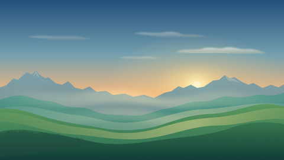 | 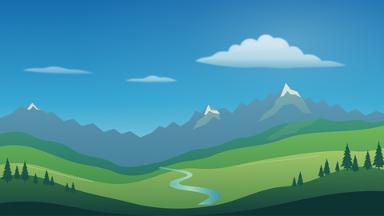 |
| **Morning Glow**, a fresh sunrise theme. Soft clouds and haze move through golden light over a layered mountain valley. | **Sunlit Valley**, a bright daytime theme. White clouds drift above green ranges, forested hills and a sunlit valley floor. |
| 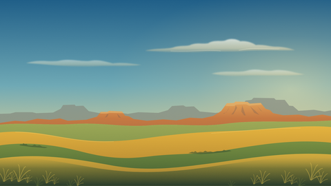 | 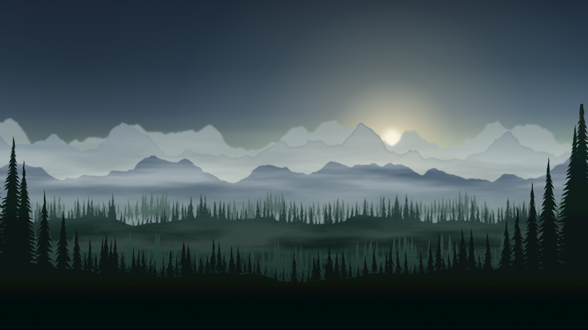 |
| **Golden Prairie**, a warm afternoon theme. Open grassland, distant mesas and subtle grasses move beneath an expansive sky. | **Misty Forest**, a quiet morning theme. Pale dawn light, blue-grey ranges and dark pines sit in two banks of drifting fog. |
| 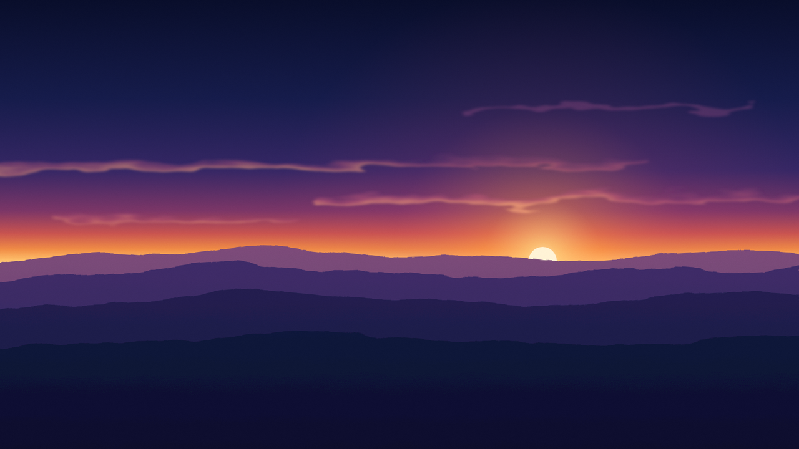 | 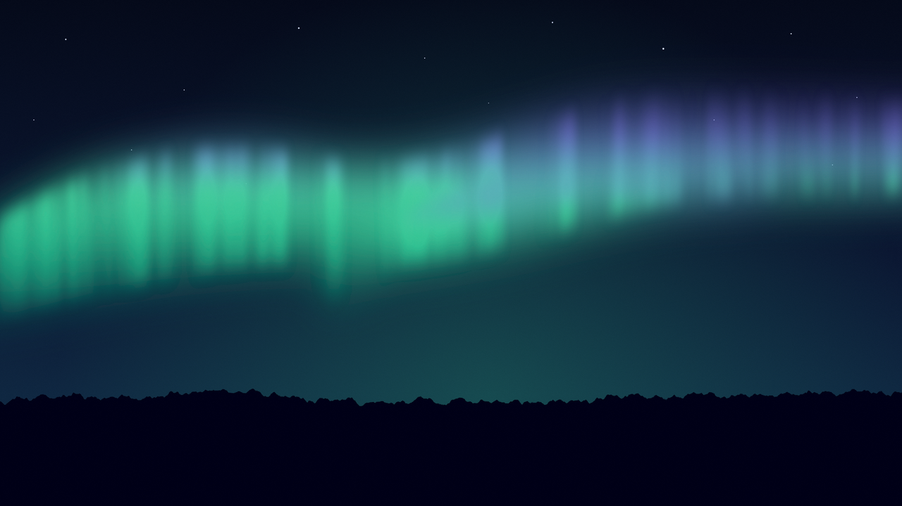 |
| **Dusk**, the evening theme. Warm amber against deep blue ridges; lit wisps of cloud drift above the ridges. | **Aurora**, the night theme. An emerald curtain with a violet fringe over a dark treeline; the curtain breathes and sways. |
| 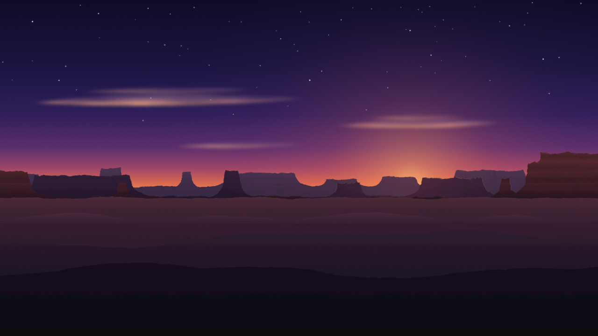 |  |
| **Desert Twilight**, an evening theme. Mesas are backlit by the afterglow as the sky turns from late afternoon to twilight and stars appear. |  |

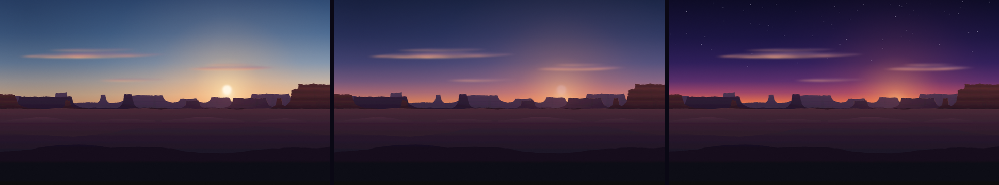

*Desert Twilight at 0, 120 and 240 seconds after Home appears.*

## Special themes

Scenes for a particular space or occasion, chosen when you want them. Five
seasonal scenes join Open Bay, with the same quiet landscapes, dark-room
palettes and soft, continuous atmospheric motion as the everyday collection.

| | |
|---|---|
| 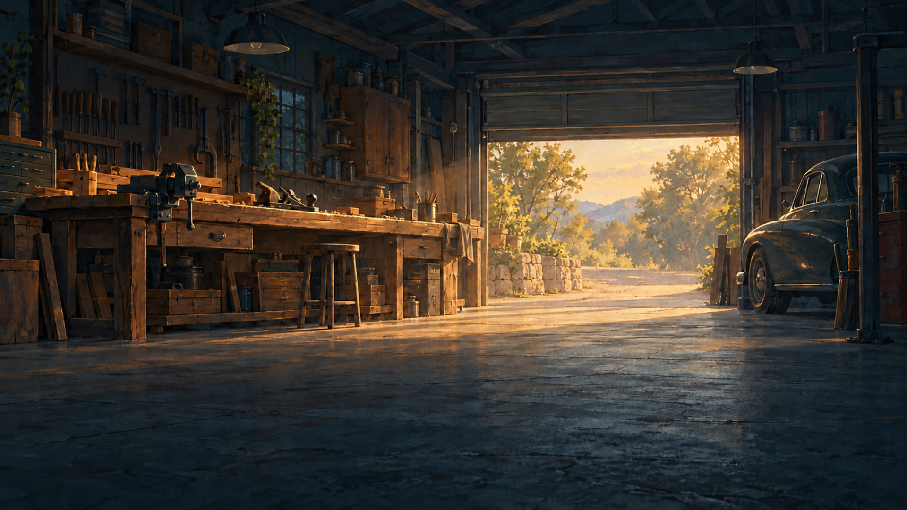 | **Open Bay**, a warm garage workshop in afternoon light. Walnut, cool slate shadows and an unbranded classic car, with faint haze and drifting dust. Choose it in Single Theme, or deliberately add it to a custom rotation. |
| 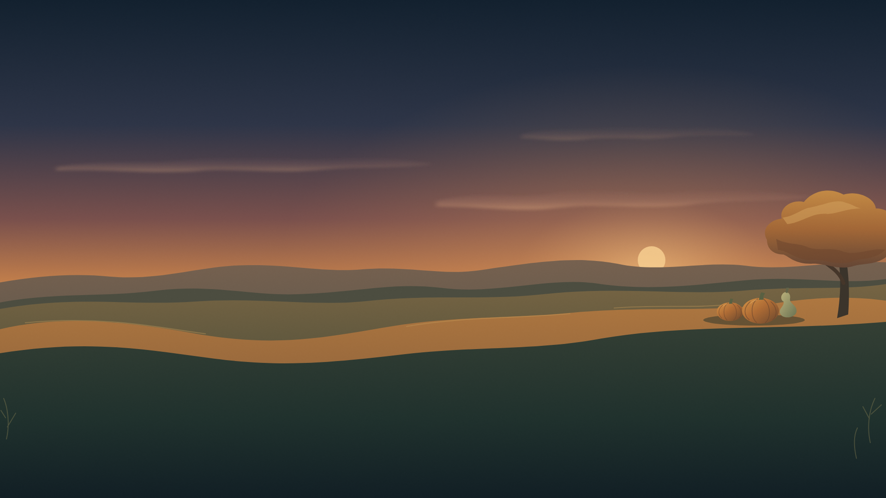 | **Harvest Evening**, a gentle Halloween harvest scene. Autumn colors and pumpkins with slowly drifting atmosphere. |
| 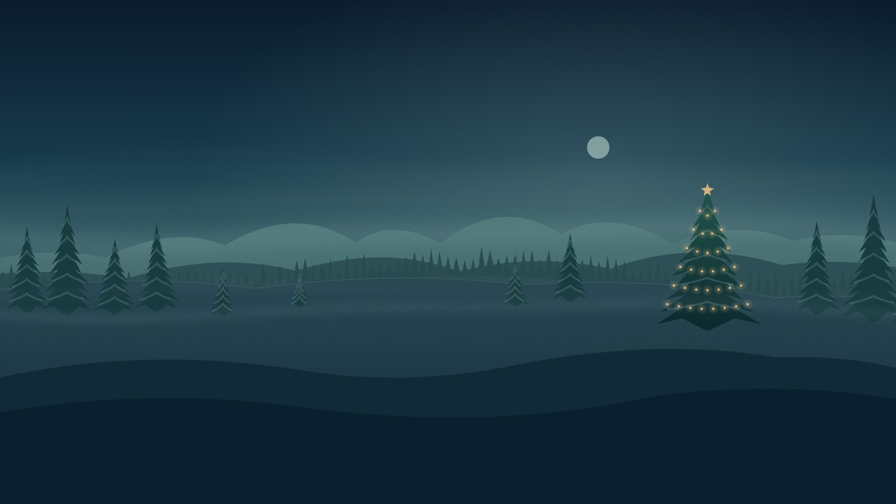 | **Christmas**, a winter evening with a warmly lit evergreen and soft atmospheric drift. |
| 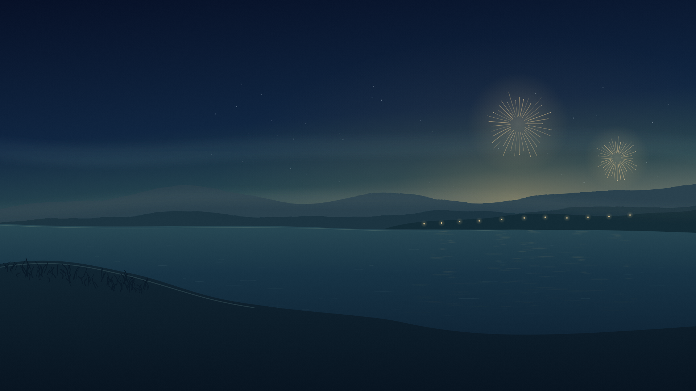 | **New Year**, a midnight celebration with restrained gold light and slowly moving lake haze. |
| 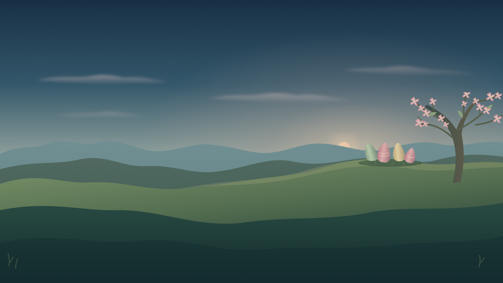 | **Easter**, a quiet spring scene with flowers, colored eggs and slow clouds. |
| 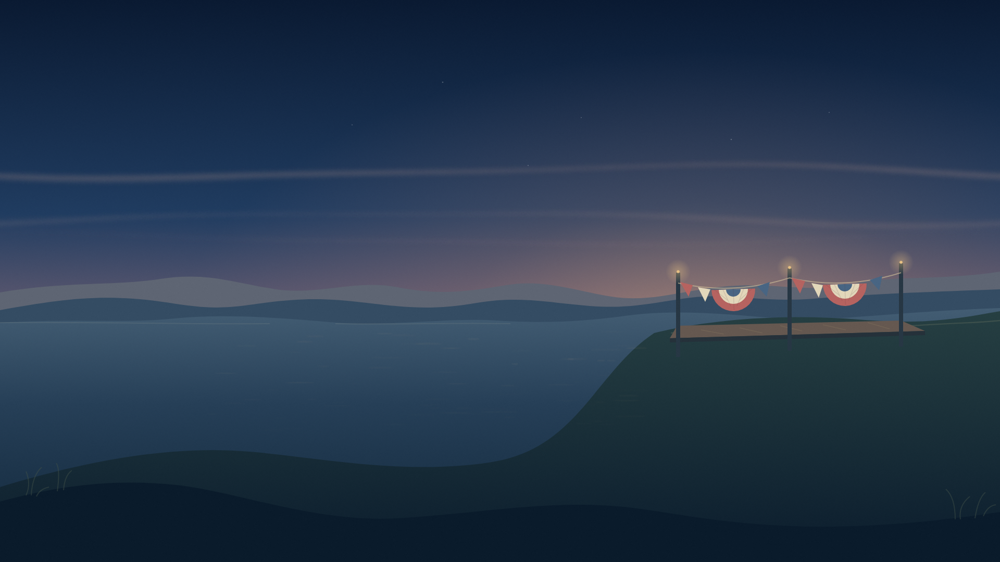 | **July Fourth**, a summer celebration with restrained red, cream and blue details and gentle atmospheric drift. |

Special themes stay out of the recommended Follow the Day schedule and Surprise
Me's default pool. They are always available in Single Theme, and can be added
to a custom pool. [Open Bay artwork and visual checks](open-bay-verification.md).
[Seasonal artwork and verification](seasonal-themes.md).

*Christmas on the Android TV emulator. The tiles are local demo stand-ins.*

Settings, Theme previews the packs live behind the panel. Single Theme keeps
one scene, Follow the Day uses editable local-time periods with fixed or
shuffled theme pools, and Surprise Me makes one stable choice per day. A theme
pack is a folder of images and a short manifest, bundled in the app or pushed
to the TV over ADB and reloaded without reinstalling Hearth. The format and
development loop are in [docs/theme-packs.md](theme-packs.md).

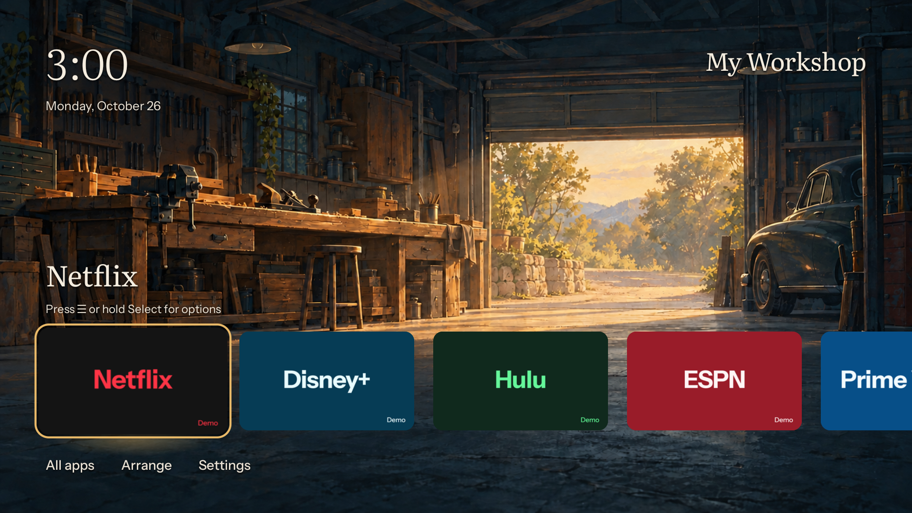

**A title for your space.** Settings → Theme (Appearance) → Home label lets you show a
short title such as My Workshop, Game Room, or Welcome Home. Off by default,
with no artwork text or extra focus stop. Edit, hide, or clear it at any time;
your choice is saved locally and works across themes.

The artwork stays unobscured, with no gray gradient patches behind text.
All thirteen scenes keep their slow layered motion; Reduce motion makes them
still. Appearance groups the three modes on one line, shows only the selected
mode's controls, and keeps period renaming and About on their own screens.

| | |
|---|---|
| 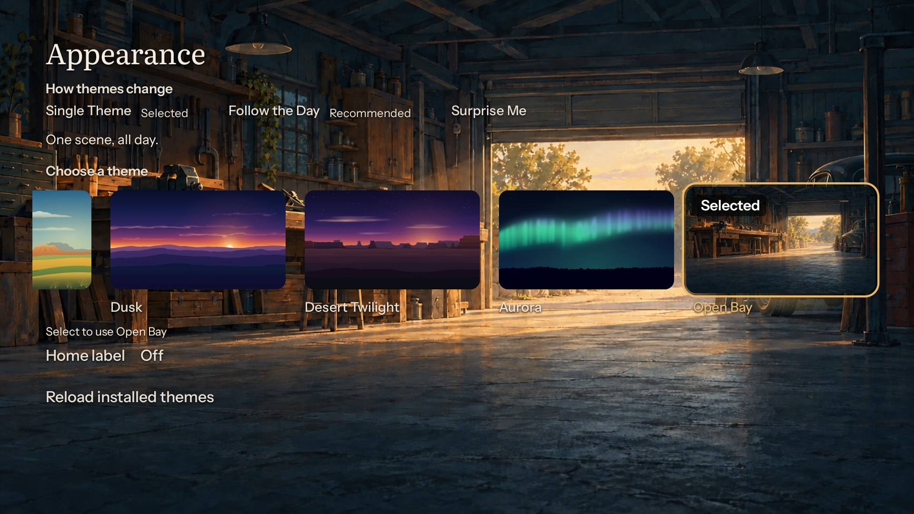 | 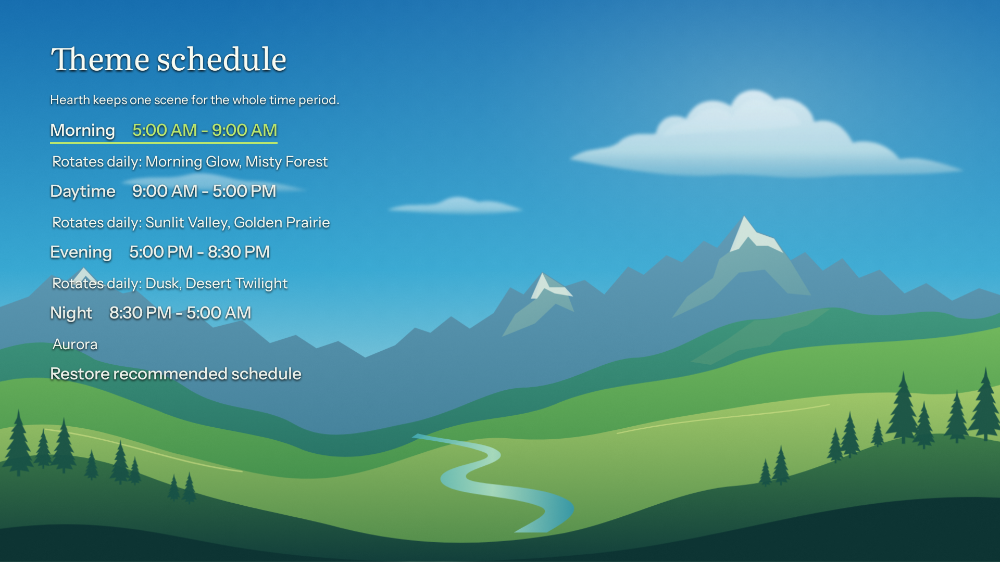 |
| **Simple choices up front.** Pick one scene, follow a recommended schedule, or let Hearth make one stable daily choice. | **Power behind one screen.** Every period can be renamed, moved, fixed to one theme, or given a shuffled pool. |

[Back to Hearth](../README.md) · [Create or install a theme pack](theme-packs.md)
